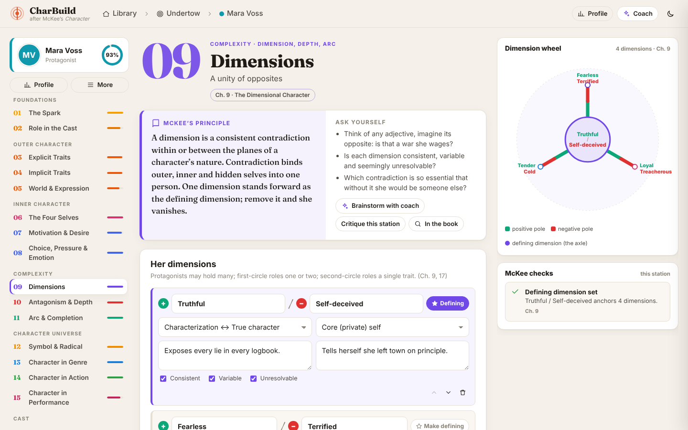
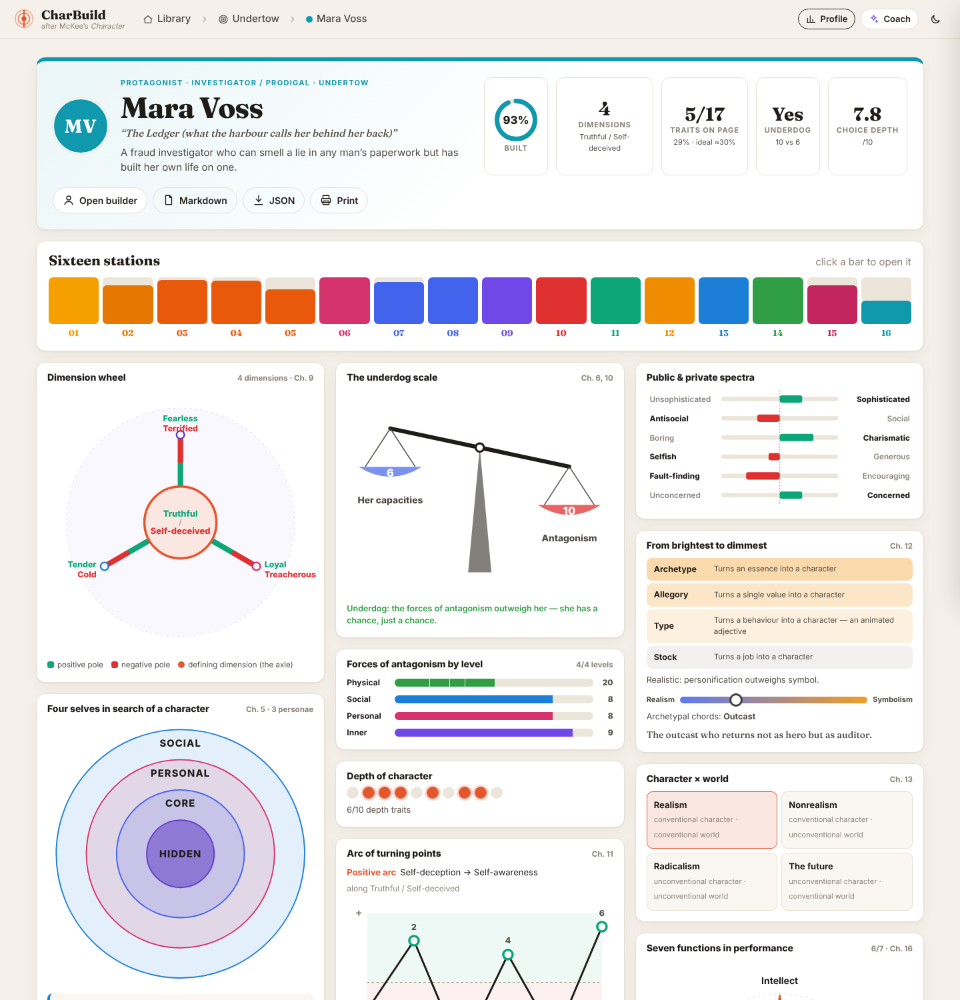
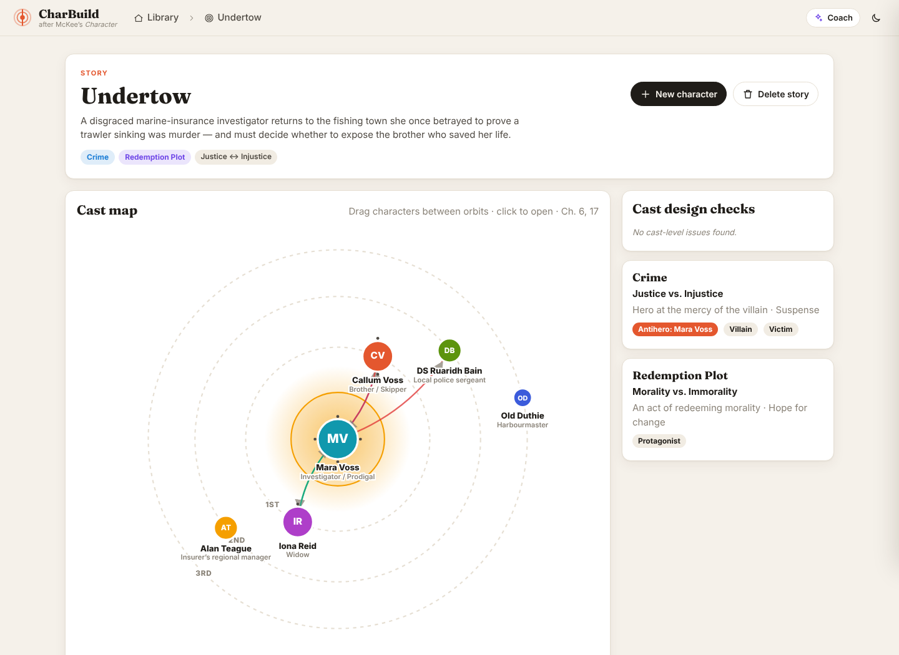
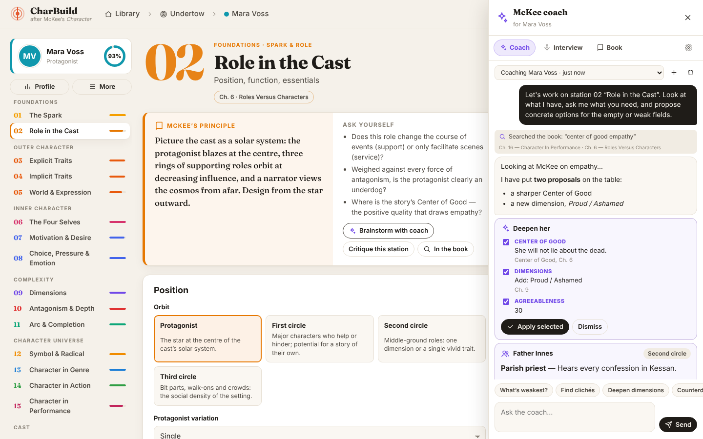
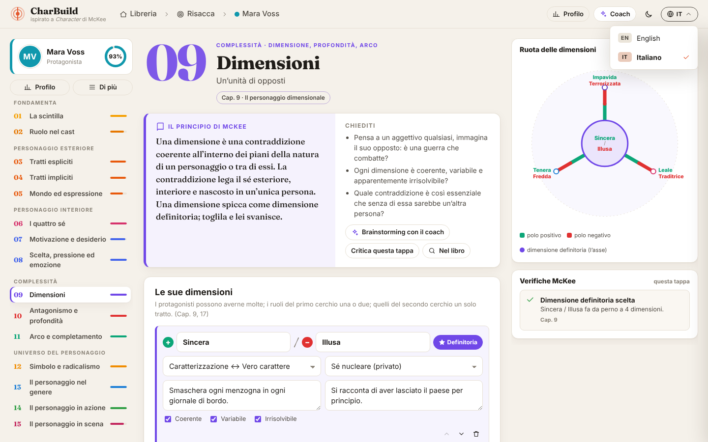

# CharBuild — a character builder after McKee’s *CHARACTER*

A web app for designing fictional characters, built around Robert McKee’s
*Character: The Art of Role and Cast Design for Page, Stage, and Screen*
(2021). There are sixteen **stations**, one per stage of the book’s argument.
Each one has structured fields, a live infographic, and rule-of-thumb
**“McKee checks”** that cite the chapter they come from. An optional **AI
coach** can brainstorm with you, critique a station, search the book, propose
values you apply with one click, or play the character in a self-story
interview. It runs on Claude, OpenAI, Gemini, OpenRouter, Mistral, Groq,
DeepSeek, xAI, a local Ollama or LM Studio model, or any OpenAI-compatible
server.

The whole app is available in **English and Italian** (*italiano*): pick the
language from the menu in the top-right corner.



## Quick start

```bash
npm install
npm start            # → http://localhost:4133
```

The server listens on every network interface. When it starts, it prints a
`Network:` address such as `http://192.168.1.20:4133`, and any phone,
tablet or computer on the same LAN can open that address.

If another device can't connect, allow incoming connections on port 4133 in
the host's firewall. On Windows, accept the prompt that asks whether to let
Node.js through, or add an inbound rule for TCP port 4133. On macOS, allow
`node` under System Settings → Network → Firewall.

To keep the app private to the host machine, start it with
`HOST=127.0.0.1 npm start`.

You need Node 20.12 or later (it was tested on Node 22). On first run the app
creates a sample story, *Undertow*, with a cast of six, so every chart has
data to show. Delete the story whenever you like, or restore it from the
library.

The AI coach is optional. To turn it on, open the coach’s **⚙ settings**
tab, choose a provider and paste its API key. You can also put the key in the
environment or in a `.env` file before you run `npm start` (see
`.env.example`), for example `ANTHROPIC_API_KEY` or `OPENAI_API_KEY`.

### Updating

```bash
git pull                 # on the branch you run from
npm install              # in case dependencies changed
# stop the running server (Ctrl+C in its terminal), then:
npm start
```

The startup banner and the library footer show the running version
(`CharBuild 1.4.0 · <commit>`). If the server is older than the page, for
example after pulling without restarting it, the app says so. A port that's
still taken by the old process gives "Port 4133 is already in use".

## The sixteen stations

| # | Station | McKee | What you build |
|---|---------|-------|----------------|
| 01 | The Spark | Ch. 3–5 | Inspiration sources (the five spheres), the telling detail, the Magic If, outside-in vs inside-out, in-character improvisation, the four researches |
| 02 | Role in the Cast | Ch. 6 | Orbit (protagonist / 1st / 2nd / 3rd circle), support vs service, protagonist variations, the 8 protagonist essentials, Center of Good, foil and narrator functions |
| 03 | Explicit Traits | Ch. 7 | The 18 explicit-trait topics. An eye toggle marks which traits are dramatized, so the **3/10 rule** can be measured. Public and private trait spectra; credibility, originality, intrigue |
| 04 | Implicit Traits | Ch. 7 | The Big Five spectra, IQ/EQ/creative/curiosity/cultural intelligence, attitudes, McKee’s interrogation questions, mood, temperament, attitude to authority |
| 05 | World & Expression | Ch. 7 | Time and space, levels of conflict, physical, social and personal settings, cultural restraints, moral imagination, the 8 setting↔character relations, the 9 ways to express characterization |
| 06 | The Four Selves | Ch. 5 | Social, personal, core and hidden selves (the *Mad Men* method), variations of the self, a repertoire of personae along power and intimacy |
| 07 | Motivation & Desire | Ch. 8 | The 12 inside-out motivations (from primal to elevated), outside-in forces, backstory patterns, inciting incident → super-objective → object of desire |
| 08 | Choice, Pressure & Emotion | Ch. 8 | Positive or negative dilemma, risk × freedom (“choice depth”), value spectra, the 12 emotions in 6 oppositions, background feelings, signature reactions, decision paths |
| 09 | Dimensions | Ch. 9 | Contradictions classified by McKee’s 6 types and 4 levels of self, a behaviour for each pole, consistent / variable / unresolvable tests, the **defining dimension** |
| 10 | Antagonism & Depth | Ch. 10 | Forces of antagonism on every level, weighed against her capacities (the **underdog scale**), conscious desire vs subconscious counterdesire, inner-conflict patterns, the 10 depth traits, text and subtext |
| 11 | Arc & Completion | Ch. 11 | Preparation (need) → revelation → change → completion, theory of identity, arc along a dimension, plot of character, fate vs destiny, turning points you can drag on the chart |
| 12 | Symbol & Radical | Ch. 12–13 | Realism ↔ symbolism, archetype / allegory / type / stock, a stereotype check, the character × world quadrant, the 9 radical subtractions |
| 13 | Character in Genre | Ch. 14 | The story’s primary genres (10 plots of fortune, 6 plots of character), each with its core value, event, emotion and cast, and her core-cast position |
| 14 | Character in Action | Ch. 15 (and 4) | Past, present and future self-story, the 12 MO themes with their twists, sense of probability, a scene builder (objective → action → counteraction → value change) |
| 15 | Character in Performance | Ch. 16 | The 7 functions, discovery and recognition, suspense = curiosity × concern |
| 16 | Cast Relationships | Ch. 17 | Links to castmates, and which of her dimensions each one draws out (the *Pride and Prejudice* model) |

Supporting characters get lighter expectations. Second-circle roles are only
expected to fill a few stations, and third-circle roles fewer still, which
follows McKee’s advice to keep outer-circle roles lean.

## Visual and interactive

* **Live infographics per station:** the spheres of inspiration, the cast
  orbit, the trait canvas with its 3/10 meter, a personality radar, rings of
  setting, the four-selves rings, the ladder of motivation and the desire
  chain, the choice-depth gauge with the dilemma balance, the dimension
  wheel, the underdog scale, an antagonism stack, the depth dots, an arc
  chart with draggable points, the symbolic spectrum, genre sheets, scene
  value-change arrows, the performance star and the relationship web.
* **Profile:** a one-page infographic “character bible” for each character,
  which you can print or export as Markdown or JSON.
* **Cast map:** McKee’s concentric circles. Drag characters between orbits;
  curved arrows show who helps or hinders whom.
* **McKee checks:** for example “No true dilemma yet”, “Not an underdog”,
  “Desires don’t contradict”, “Repetition is the mortal enemy”,
  “Protagonist out-dimensioned” and “Dormant dimensions”. Each one names its
  chapter.
* Autosave, light and dark themes, a responsive layout down to phone width,
  and keyboard access.





## AI coach (optional)



The ✦ **Coach** drawer has four tabs:

* **Coach.** An agent that reads the live profile and the station you’re
  on. It has four tools:
  * `search_mckee_book` runs a full-text search over **your copy** of the
    book.
  * `analyze_character` runs the same diagnostics as the app.
  * `propose_character_updates` proposes values for specific fields. These
    are validated against the schema, and you tick the ones you want and
    click *Apply selected*.
  * `propose_cast_member` suggests a new role, such as a foil, which you can
    add with one click.
* **Interview.** McKee’s self-story exercise (Ch. 4). The character answers
  in her own voice, self-deceptions included. *Distill into profile* hands
  the transcript to the coach, which turns it into proposals.
* **Book.** Local search over the epub. It needs no API key.
* **Settings.** Choose the provider, then set its API key, base URL, model
  and effort. *Load models* lists the models your key can use, and *Test
  connection* checks that it works.

### Providers

| Provider | How it connects | Key (setting or env var) | Default model |
|----------|-----------------|--------------------------|---------------|
| Anthropic Claude | Anthropic SDK (native) | `ANTHROPIC_API_KEY` | `claude-opus-5-5` |
| OpenAI | Chat Completions | `OPENAI_API_KEY` | `gpt-6.1-sol` |
| Google Gemini | Google’s OpenAI-compatible endpoint | `GEMINI_API_KEY` or `GOOGLE_API_KEY` | `gemini-3.8-flash` |
| OpenRouter | OpenAI-compatible | `OPENROUTER_API_KEY` | `openrouter/auto` |
| Mistral | OpenAI-compatible | `MISTRAL_API_KEY` | `mistral-large-latest` |
| Groq | OpenAI-compatible | `GROQ_API_KEY` | `openai/gpt-oss-120b` |
| DeepSeek | OpenAI-compatible | `DEEPSEEK_API_KEY` | `deepseek-chat` |
| xAI Grok | OpenAI-compatible | `XAI_API_KEY` | first model the key can use |
| Ollama (local) | `http://localhost:11434/v1` | none | first installed model |
| LM Studio (local) | `http://localhost:1234/v1` | none | the loaded model |
| Custom | any OpenAI-compatible base URL | `CUSTOM_LLM_API_KEY` (optional) | first listed model |

* Each provider also reads `<PREFIX>_BASE_URL` and `<PREFIX>_MODEL`, for
  example `OPENAI_MODEL` or `OLLAMA_BASE_URL`. Settings saved in the app take
  precedence over the environment.
* `AI_PROVIDER` chooses the starting provider, for example `AI_PROVIDER=gemini`.
  If it isn't set, the app uses the first provider it finds a key for.
* Every provider gets the same tools and the same McKee method. Local models
  get a shorter system prompt and look up field paths with an extra tool,
  because their context windows are smaller.
* For coaching, a local model has to support tool calling, for example qwen3
  or llama3.1, and needs a context window of 16k tokens or more. If a model
  can't call tools, the coach still answers, but book search and one-click
  proposals are switched off for that reply.
* "Local" means the computer running CharBuild, because that machine is the
  one that calls the model.
* Model lists change often. If a default model is retired, pick another one
  with *Load models*.
* A conversation stays with the provider it started on. To try another
  provider, start a new conversation.

Implementation notes:

* With Claude, the coach streams with adaptive thinking (the reasoning
  summary shows in the chat), uses server-side refusal fallbacks, and caches
  the prompt prefix. With OpenAI-compatible providers, it streams Chat
  Completions with function calling. When a model sends its reasoning
  (DeepSeek, OpenRouter and some others do), that also shows in the chat.
* Conversation history is **append-only**. The system prompt and tool set
  stay fixed for each conversation. The current character state is sent as a
  snapshot block inside the next message whenever it has changed, rather
  than by editing earlier context. Chats are saved in `data/chats/`.
* API keys are stored only on your machine, in `data/settings.json`, and
  the server never sends them back to the browser.
* **On a LAN:** every device on the network can use the coach, and the coach
  uses the host's key. Only the host machine can change the provider, key,
  model or effort. To allow changes from other devices too, start the server with
  `ALLOW_REMOTE_SETTINGS=1`.

Without a key, everything except the Coach and Interview tabs works.

## Languages

CharBuild speaks **English** and **Italian**. The globe menu in the top-right
corner of every page switches language on the spot; the choice is remembered
in the browser, and the first visit follows the browser’s language.



* **Everything is translated:** the sixteen stations (principles, questions,
  fields, hints), McKee’s catalog of options, the infographics, the McKee
  checks, the Markdown export, the coach drawer and its settings, and the
  server’s messages.
* **Your data doesn’t change.** Only labels are translated; saved values and
  option ids are the same in every language, so you can switch at any time.
* **The coach follows you.** When the interface is in Italian the coach and the
  interview answer in Italian (proposed field values included), and refer to the
  stations by their Italian names. Switching language mid-conversation is fine.
* **The book stays in English.** It is your own copy of the original edition.
  Italian searches are matched to McKee’s English vocabulary (*dimensione
  definitoria* → *defining dimension*, *incidente scatenante* → *inciting
  incident*…), and passages are shown as written.
* **The sample story is translated too.** In Italian it is *Risacca*. The
  library offers to swap the sample to the current language; on first run the
  sample follows `CHARBUILD_LANG` (or the host’s `LANG`).

Translations live in `shared/locales/it/` (`data.js` for the builder data,
`ui.js` for the interface). English strings are the keys. Run
`node scripts/i18n-keys.mjs` to list anything untranslated; the test suite fails
if a string is missing. To add a language, register it in `shared/i18n.js`
(`LOCALES`) and add `shared/locales/<id>.js`.

## The book

The epub in `docs/` is parsed **at runtime**. It is split into about 600
short passages, labelled by chapter and section, and indexed for keyword
ranking (BM25). No book text is copied into the source code: the station
guidance is paraphrased, with chapter references. You can point
`BOOK_PATH` at a different copy.

## Saving, export and import

Everything is stored on the computer running the server, in `data/` (or `DATA_DIR`).

**Saving.**
* Every edit is saved automatically a moment after you stop typing, into
  `data/db.json`. Writes are atomic: the file is written to a temporary name,
  then renamed.
* If the disk write fails, the app says so ("Could not save…") and retries.
  It never shows "All changes saved" for a save that didn't happen.
* Working in two tabs or on two devices: when you come back to a tab, it picks
  up what was saved elsewhere. If both edit the same story or character at the
  same time, the later save is refused, and you choose which version to keep.
* After an update, pages still open from the old version keep saving
  normally. The page offers **Reload** as soon as it notices that the server
  has been updated.
* Coach conversations are kept in `data/chats/`, and AI settings in
  `data/settings.json`.

**Backups** live in `data/backups/`.
* A snapshot of the library is taken before every import, restore or
  library replacement, and every half hour while you work.
* The 20 newest are kept, plus the newest of each of the last 14 days.
* **Backups** in the library lists them. Restoring one first snapshots the
  current library, so a restore can be undone too.
* If `db.json` is ever unreadable at startup, it is set aside
  (`db.json.corrupt-…`) and the newest backup is loaded.

**Export** (*Export…* in the library, *Export* on a story, or the character menu).
* Pick whole stories (each comes with its cast), single characters inside a
  story, or characters without a story.
* **JSON** is the re-importable format, and can include the coach
  conversations. **Markdown** gives readable story and character bibles.
* Files are named after what they hold, e.g. `charbuild-undertow-2026-10-16.json`.

**Import** (*Import* in the library, or drop a `.json` file anywhere on the page).
* A preview lists every story and character in the file, each marked as
  *new*, *unchanged* or *already in your library* (and whether your copy or
  the file's is newer). Tick what you want.
* For items you already have, choose one of:
  * **Update them:** the file wins.
  * **Keep both:** the file's version comes in as a copy, with fresh ids, and
    relationships are re-pointed to the copies.
  * **Keep yours:** skip them.
* Characters whose story isn't in the file can go to their original story, to
  a story you pick, or to no story. Links to castmates who aren't there are
  removed.
* "Replace the whole library" is available behind a confirmation.
* Every import shows **Undo** (it restores the backup taken just before it).
  Files from older versions, including single-character exports, still import.

| Endpoint | |
|----------|-|
| `GET /api/export?stories=a,b&characters=c&chats=1` | Export a selection (no parameters: the whole library) |
| `POST /api/import/preview` `{data}` | What importing would do, item by item; changes nothing |
| `POST /api/import` `{data, select, conflict, target, includeChats, replace}` | Import. `conflict`: `update` / `copy` / `skip`; `target`: `keep` / `none` / a story id |
| `GET /api/backups`, `POST /api/backups`, `POST /api/backups/:id/restore` | List, take, restore backups |

## Configuration

| Variable | Default | |
|----------|---------|-|
| `PORT` | `4133` | |
| `HOST` | `0.0.0.0` | All interfaces, so the app is reachable on the LAN. Use `127.0.0.1` to make it local-only. |
| `ALLOW_REMOTE_SETTINGS` | — | Set to `1` to let other devices change the AI key, model and effort. |
| `DATA_DIR` | `./data` | |
| `AI_PROVIDER` | first provider with a key | `anthropic`, `openai`, `gemini`, `openrouter`, `mistral`, `groq`, `deepseek`, `xai`, `ollama`, `lmstudio` or `custom` |
| `ANTHROPIC_API_KEY`, `OPENAI_API_KEY`, … | — | Optional. Each provider’s key, see [Providers](#providers). You can also set them in the app. |
| `<PREFIX>_MODEL`, `<PREFIX>_BASE_URL` | per provider | For example `OPENAI_MODEL` or `OLLAMA_BASE_URL`. Settings saved in the app take precedence. |
| `BOOK_PATH` | first `.epub` in `docs/` | |
| `CHARBUILD_LANG` | host `LANG`, else `en` | Language of the sample story seeded on first run (`en` or `it`). The interface language is chosen in the app. |

## Project layout

```
server/   Express app (index.js), JSON store, coach (ai.js), provider registry (providers.js),
          agent loops per API (llm/anthropic.js, llm/openai.js), epub search (book.js), sample seed
shared/   Used by both browser and server: McKee catalog, the 16 stations, data model,
          field index and validation, analysis and checks, Markdown export,
          i18n (i18n.js, i18n-data.js) and the Italian dictionaries (locales/)
public/   Single-page app (plain ES modules, no build step): app.js, forms.js, viz.js,
          castmap.js, assistant.js, transfer.js (export/import/backups), css/app.css
test/     node:test suites: the agent loops against scripted fake clients, the real OpenAI SDK
          against a local mock server, import/export/backups, translations
```

```bash
npm test
```
